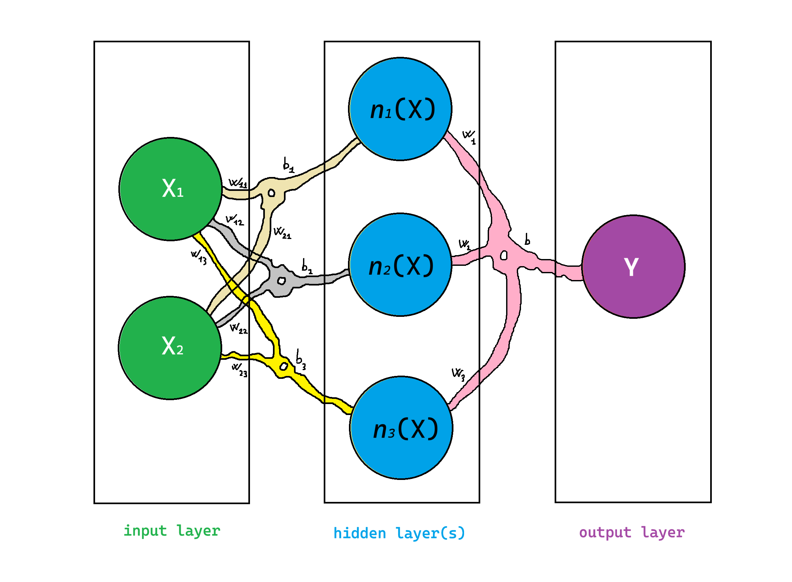
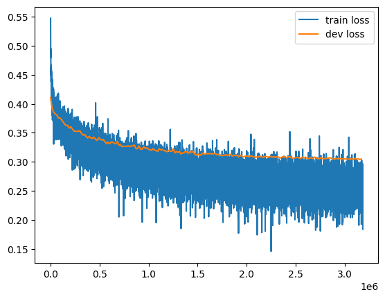
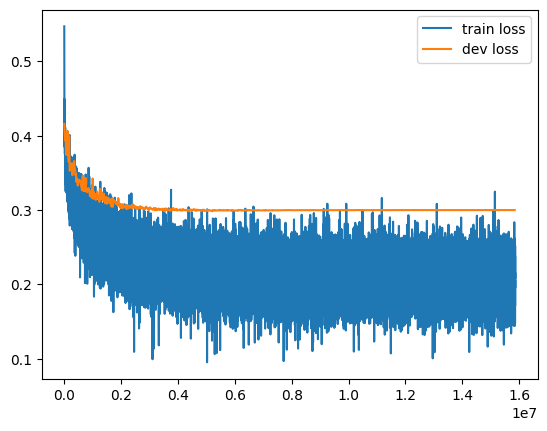

# Intelligence from Scratch

A practical journey into how neural networks work, building their components and observing what happens during training. The notebooks progress from a small scalar automatic differentiation engine to autoregressive models that generate Italian names one character at a time.

This project is a collection of experiments and study notes inspired by Andrej Karpathy’s **Neural Networks: Zero to Hero** series. The explanations in the notebooks are mostly in English.

## Learning path

| Order | Notebook | Topics |
| --- | --- | --- |
| 1 | [MLP](01_MLP/MLP.ipynb) | The `Value` class, computational graphs, backpropagation, comparison with PyTorch, and implementations of `Neuron`, `Layer`, and `MLP`; experiments with gradient resetting, learning rates, decay, and adaptive learning rates. |
| 2 | [ACLM](02_ACLM/ACLM.ipynb) | Autoregressive Character-level Language Model: bigrams and Markov chains, a single-layer neural model, softmax and temperature, negative log-likelihood, embeddings, and an MLP with a three-character context; initialization, batch normalization, and activation and gradient diagnostics. |
| 3 | [ACLM+](03_ACLM+/ACLM+.ipynb) | An MLP with two hidden layers of 100 neurons each, a three-character context, and two-dimensional embeddings; training over epochs, learning rate decay, comparison of training and validation losses, and observation of overfitting. |

The supporting [italian_names_wiki_parser](02_ACLM/italian_names_wiki_parser.ipynb) notebook collects names through the Wikimedia Commons API and builds the lists used in the experiments.

## From an MLP to learning curves



The first notebook builds the network and gradient computation. Subsequent notebooks use PyTorch tensors and autograd while keeping the forward pass, loss calculation, and parameter updates explicit.

| Training | Overfitting experiment |
| --- | --- |
|  |  |

These plots were extracted from the saved outputs of **ACLM+** and show loss on a `log10` scale. The gap between training and validation losses illustrates the limits of generalization. These are results from individual runs, not benchmarks.

## Local setup

**Python 3.12 or later** is recommended: some f-strings in the MLP notebook use syntax introduced in Python 3.12. The notebook metadata records Python 3.14.2; the repository does not include a dependency file with pinned versions.

From the repository root:

```bash
python3 -m venv .venv
source .venv/bin/activate
python -m pip install jupyterlab ipykernel numpy matplotlib torch graphviz requests
python -m ipykernel install --user --name intelligence-from-scratch --display-name "Intelligence from Scratch"
jupyter lab
```

On Windows, activate the environment with `.venv\Scripts\activate`.

To render graphs in the first notebook, you also need **Graphviz installed on your system**, with the `dot` executable on your `PATH`. The Python `graphviz` package provides an interface to that program.

Open the notebooks in the order listed above and select the **Intelligence from Scratch** kernel. File paths are relative to each notebook’s directory: the kernel must run in `01_MLP`, `02_ACLM`, or `03_ACLM+`, depending on the notebook. You can check the current directory with `Path.cwd()` from the `pathlib` module.

The datasets are already included, so training experiments do not require running the parser or accessing the network. The parser requires a connection to Wikimedia Commons.

## Datasets

The four lists in [italian_names_dataset](02_ACLM/italian_names_dataset/) contain one name per line:

| File | Lines |
| --- | ---: |
| `italian_masculine_given_names.txt` | 2,114 |
| `italian_feminine_given_names.txt` | 373 |
| `italian_popular_masculine_names.txt` | 443 |
| `italian_popular_feminine_names.txt` | 233 |

**ACLM** loads the `popular` lists; **ACLM+** loads the two full lists. Names are converted to lowercase, and the `.` character is used to delimit names and initialize the context. The data-splitting sections use 80% for training, 10% for validation, and 10% for testing.

In the parser, `popular` means filtering for at least 15 subcategories (`categoryinfo.subcats`) on Wikimedia Commons; it does not represent a demographic ranking of Italian name frequency. The counts above describe the files included in the repository before any cleaning or deduplication.

## Reproducing the experiments

The notebooks contain successive experiments that reuse and redefine variables. Read each section before running it, and restart from the configuration cells when comparing training runs. Some loops perform thousands of updates; execution time depends on your machine and chosen parameters.

- **Dataset encoding:** the two masculine name lists contain bytes that are not valid UTF-8. If `open()` raises a `UnicodeDecodeError`, specify a compatible encoding, such as `encoding="latin-1"`, in the cells that read them, and check that accented characters are decoded correctly.
- **ACLM checkpoint:** `02_ACLM/bn_model.pkl` is included, but the loading cell assigns the result of `pickle.load()` directly to several variables, while the saving cell writes a dictionary of NumPy arrays. To reuse a checkpoint saved in that format, access its keys and convert the arrays to tensors; alternatively, follow the initialization and training cells. The saving cell overwrites the file.
- **Parser:** it writes `.txt` files to the current directory. To update the datasets used by the models, move the outputs to `02_ACLM/italian_names_dataset/`.
- **ACLM+:** it defines `BatchNorm1d`, but the displayed network configuration uses `Linear` and `Tanh`. The embedding `C` is not included in the list of parameters being updated, so it remains fixed in these experiments. A test split is created, but no final evaluation on that split is reported.

Saved outputs and figures let you follow the learning path without rerunning training. There is no automated test suite, and the seeds do not control every random initialization: new runs may produce different names and curves.

## References

- [Neural Networks: Zero to Hero — Andrej Karpathy](https://www.youtube.com/playlist?list=PLAqhIrjkxbuWI23v9cThsA9GvCAUhRvKZ)
- [micrograd](https://github.com/karpathy/micrograd), the reference cited in the MLP notebook for scalar automatic differentiation.

## License

The repository does not currently include a `LICENSE` file.

## Note

This file (ONLY THIS FILE) (`README.md`) has been produced by GPT-6.1-Sol using Codex.
